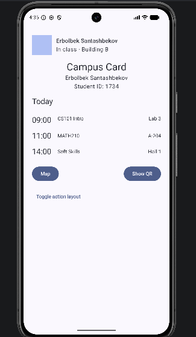
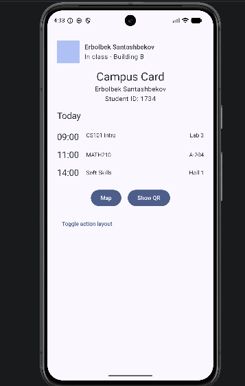
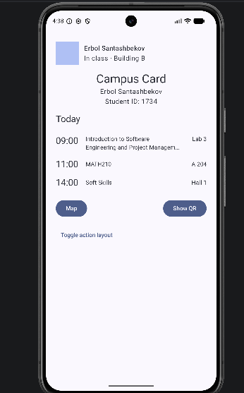
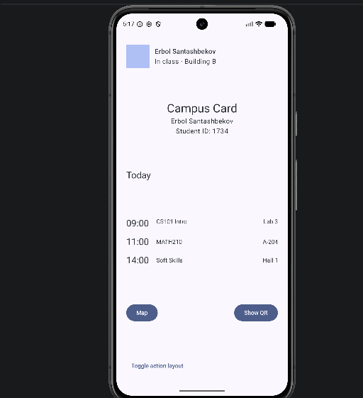
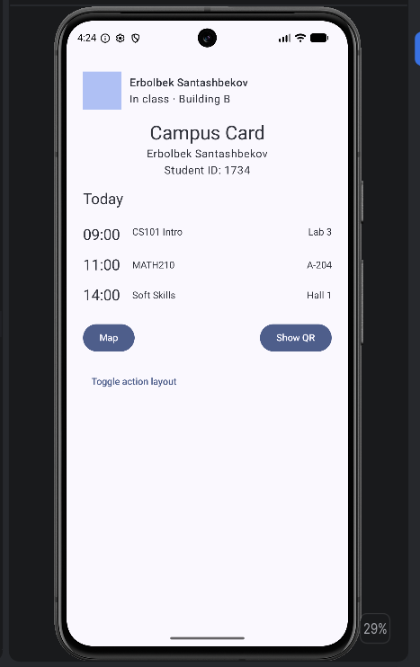

# Лабораторная работа 4 — Введение в Android с Jetpack Compose

**Имя:** Эрбол Санташбеков
**Группа:** IT-124
**Student ID:** 1734
**Проект:** CampusCardLab (пакет kg.iuca.campuscard)

---

## Часть B3 — эксперименты с alignment и arrangement (два из четырёх)

**Эксперимент 3 (Arrangement.Center).**
Я заменил verticalArrangement у внешней Column на Arrangement.Center. Весь контент собрался вместе в середине экрана. Промежутки по 16 dp между блоками пропали, потому что их задавал spacedBy, и теперь блоки стоят вплотную друг к другу.

**Эксперимент 4 (Arrangement.SpaceBetween).**
Шапка осталась наверху, ссылка Toggle прижалась к нижнему краю, а свободное место поровну разошлось между блоками посередине.

---

## Упражнение 1 — `horizontalAlignment` на `Column`


Блок с надписью Campus Card, моим именем и Student ID стоит по центру, потому что у его внутренней колонки задано horizontalAlignment = Alignment.CenterHorizontally. Шапка, подпись Today и строки расписания остались слева.

---

## Упражнение 2 — `SpaceBetween` и `Center` на `Row`




С SpaceBetween кнопки разошлись по разным краям экрана. С Center они собрались рядом, в середине. Я оставил SpaceBetween, потому что он лучше сочетается с общим выравниванием по краям и кнопки выглядят аккуратнее.

---

## Упражнение 3 — вертикальное выравнивание в строке расписания




Top и CenterVertically отличаются, когда у элементов в одной строке разная высота (например, двухстрочное название предмета и время в одну строку). При `Top` время стоит на уровне первой строки названия. При CenterVertically оно сдвигается на середину между двумя строками.

---

## Упражнение 4 — Modifier.weight(1f) для названия предмета


Длинное название предмета перенеслось на две строки, а в конце появилось многоточие (`...`). Аудитория осталась справа и не уехала за экран, потому что у названия задан Modifier.weight(1f): оно занимает только свободное место между временем и аудиторией, у которых фиксированная ширина.

---

## Упражнение 5 — вынесенные composable-функции

```kotlin
fun ProfileHeader(name: String, status: String, modifier: Modifier = Modifier)
fun ScheduleRow(time: String, title: String, room: String, modifier: Modifier = Modifier, verticalAlignment: Alignment.Vertical = Alignment.CenterVertically)
fun ActionBar(useSpaceBetween: Boolean, modifier: Modifier = Modifier)
```

---

## Упражнение 6 — `Arrangement.SpaceBetween` на внешней `Column`



С SpaceBetween на внешней колонке элементы слишком сильно расходятся: расписание уезжает в середину экрана и отрывается от подписи`Today. Мне кажется, для карточки студента такой вариант выглядит беспорядочно. Поэтому я оставил всё компактно сверху через spacedBy(16.dp), так лучше.

---

## Итоговый экран


